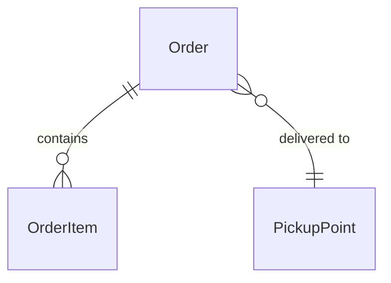

# Diagrams

A diagram is drawn when it helps the developer understand or check a decision faster than text. There is no
mandatory set. Research draws the system **as it is**; design draws it **as it will be**, in the same notation when
an as-is diagram exists, so the difference is visible.

## Which one

| The change… | Diagram | Mermaid |
| --- | --- | --- |
| adds or changes models, tables, links | ERD | `erDiagram` |
| makes components or services exchange calls over time | Sequence | `sequenceDiagram` |
| has statuses and transitions | State Machine | `stateDiagram-v2` |
| moves data through several places (import, sync, export) | Data Flow | `flowchart LR` |
| creates a system or service and its boundaries | C4 context or container | `flowchart` with a `subgraph` per system |

C4 uses `flowchart`, not Mermaid's experimental `C4Context`: it renders the same everywhere.

## How

- Mermaid in a fenced `mermaid` block inside the document: it renders in pull requests, the tracker and editor
  previews, and diffs as text.
- Names are the code's names for code things, `CONTEXT.md` terms for domain things.
- One diagram answers one question; its title line says which («Order payment: who confirms»).
- Only the parts the change reaches, plus one neighbour on each side for context. A diagram over ~25 nodes is split or
  moved to `design/<name>.md` and linked.
- New and changed elements are marked: `classDef new` / `classDef changed` in a flowchart, a `%% new` comment beside
  ERD fields and sequence steps.

